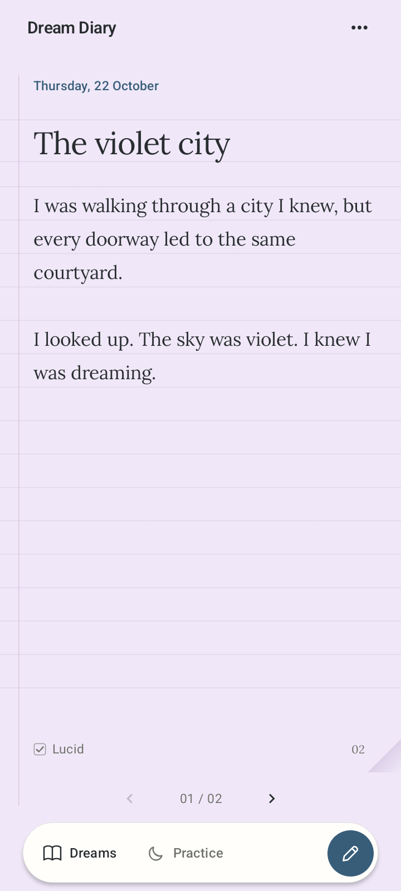
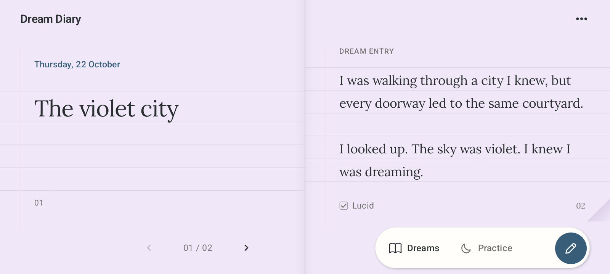
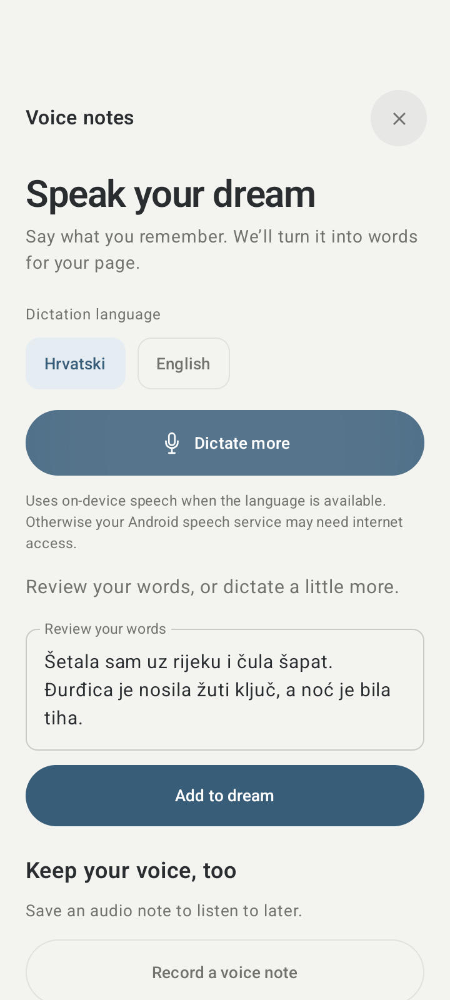
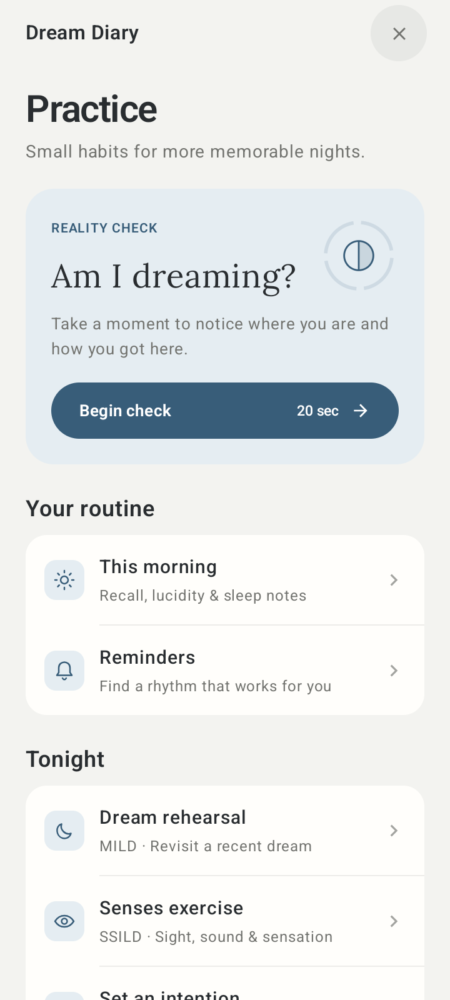
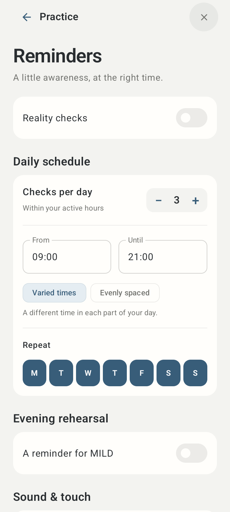
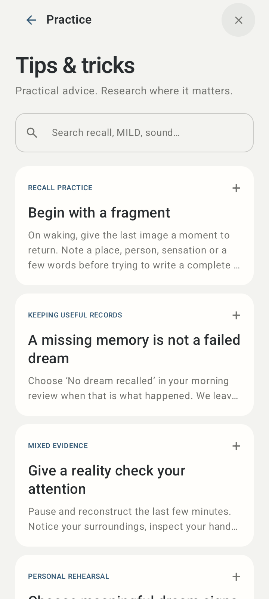

# Dream Diary development guide

A native Kotlin / Jetpack Compose dream diary. Full-screen ivory paper, Lora typography, a discreet lucid marker, and animated notebook pages in portrait and landscape. No green, mood buttons, automatic titles, or AI interpretations.

## Writing and turning pages

- Write your own title and dream directly on the page. Tap the date to change the night. Tap the microphone in the notebook header to speak instead of typing.
- Lined paper follows the measured title and writing rows, keeping text between the rules when you change fonts, text size, or orientation.
- Tap the small **Lucid** checkbox beside the page number. It is a quiet ink mark with a larger touch target; tapping it again marks the dream non-lucid. Untouched dreams remain unclassified. Checking Lucid softly fades this dream’s paper to pastel lavender, including both landscape leaves. Unchecking restores ivory; night mode uses a dim purple paper.
- Long dreams flow onto measured sheets. Typing continues onto the next sheet with the cursor, and opening the keyboard keeps sheet boundaries stable. Turn them with the arrows, folded corner, or a horizontal swipe when you aren't editing. After the last sheet, the next arrow opens the next dream.
- **Notebook options → Continue on a new page** inserts a deliberate sheet break. Editing that sheet keeps the rest of the dream intact. Layout changes reflow automatic pages without changing the underlying text.
- The **pen button** starts another dream, including more than one on the same night. Titles stay blank until you write them.
- Paper fills the screen in both orientations. Landscape uses two full-width leaves and a centred fold. Content avoids camera cutouts; the paper extends behind them.
- Edits autosave on the device. Interrupted writes keep the previous notebook. Existing version 1 notebooks migrate to version 2 without changing dream text.

## Your notebook

The **Dreams button** opens four sections. **Practice** is also available directly in the bottom toolbar:

- **Index:** dreams grouped by night, with previews, lucid status, sketch and recording indicators. Search titles, text, symbols, people, places, and dates. All search terms must match; quotation marks keep an exact phrase together. Filter by lucid / non-lucid, bookmarks, and inclusive date range.
- **Patterns:** recorded dreams and nights, lucid percentage among dreams with a known lucid choice, an eight-week activity chart, repeated symbols, people and places, and average optional lucid ratings. Tap a recurring item to find its dreams. Empty pages are excluded from these statistics.
- **Symbols:** your personal dream dictionary. Write and edit your own meanings and open the dreams linked to a symbol. Removing a dictionary meaning keeps the dreams.
- **Practice:** lucid-dreaming routines, reminders, intentions, morning review, history, optional nighttime tools, and tips with research links. Also available in **Notebook options → Lucid practice & tips**.

## Lucid practice

- **Reality-check reminders:** enable a schedule of 1–12 prompts in a chosen daytime window, on selected days. Choose varied times or fixed evenly spaced times, sound, and vibration. Notification actions open the guided check, snooze ten minutes within the allowed window, or pause until tomorrow. Daytime prompts are inexact and may be delayed by Android. Sound and vibration also follow Android channel settings. An independent optional evening reminder opens MILD.
- **Guided check:** twenty seconds of deliberate reflection, with four steps. Guides support pause, optional installed offline English device voice, transition haptics, and a dim screen. Leaving or locking the app pauses the guide. While running, the guide keeps its page awake.
- **Dream signs:** choose symbols, people and places from your own entries, or add a custom sign. Selected signs appear in reminder prompts and rehearsal suggestions.
- **MILD:** choose a recent dream or describe a remembered scene, identify an unusual detail, visualize recognizing the dream, and rehearse your own intention and goal. Move through the guide at your own pace.
- **SSILD:** a timed sequence of four quick sensory cycles followed by three slower cycles through vision, hearing and bodily sensation. The text guide works without a speech engine.
- **Intention and dream goal:** autosaving notes for the waking date of the coming night. A nighttime notification passes its actual waking date into the MILD guide.
- **Morning review:** record recall, lucidity, what prompted awareness, practices and optional sleep quality/notes. Write or record a dream from the review with the selected date. The existing morning notification now opens review and retains a direct Write action.
- **History:** completed practice, night notes and comparisons by method. Future nights are not scored. Unrecalled and unanswered nights remain unknown; a lucid diary entry counts toward its waking date. Multiple methods can share a night, so comparisons describe associations, not causation. Nighttime playback is recorded as playback, not proof of sleeping or waking.
- **Nighttime tools:** wake-back-to-bed and trained sound cues both default off. Start one session explicitly when going to sleep. Wake reminders use alarm volume and sound for at most a minute. Cues use media volume, the selected original bundled tone, a bounded count and gaps of at least fifteen minutes. Cue playback requires a completed rehearsal of the same sound in the preceding 24 hours. Audio runs in a media foreground service only while playing, with a Stop tonight action; no service or wake lock waits all night. Android notification access and, on Android 12+, Alarms & reminders access are needed. Each session ends after its events or a stop; reboot, clock/timezone changes and app updates cancel it. No automatic nightly repeat. Sound cues are experimental and scheduled, without REM detection.
- **Tips & tricks:** a searchable offline guide to recall, attentive checks, dream signs, MILD, SSILD, awareness versus control, cue training, sleep and interpreting history. Evidence labels and links distinguish supported, mixed and experimental techniques.

All practice notes are separate from the existing diary file. Every prompt and night tool starts off on a new installation. No efficacy guarantee, streaks, cloud account or AI interpretation is added.

## Tools in the options menu

- **Record or dictate:** also available from the microphone beside Notebook options. **Start dictation** turns your speech into text. Review or edit the words, dictate more if needed, then tap **Add to dream** to return to your page. The text appends to your dream and keeps your existing writing and title. You can also save microphone audio with the dream, play it back, or remove it after confirmation. Choose **Hrvatski** or **English** above Start dictation. Croatian (`hr-HR`) is the default, and your language choice is remembered. Every request explicitly uses the chosen language even if the phone's language is different. On-device recognition is preferred; if its selected language is unavailable or unsupported, the app retries through the installed Android speech service with the same language and without forcing offline recognition. This service may need internet. If that service also lacks the language, the app shows a language-specific explanation and an **Open speech settings** action. Croatian letters č, ć, đ, š, ž and their capitals are present in all three bundled notebook font files. That service's availability and processing vary by device. Devices without speech recognition can still record and type. Recording stops and saves when you close the panel, rotate, or leave the app; it does not continue in the background. Individual notes are limited to 30 minutes.
- **Sketch & handwriting:** draw or write with a finger or stylus. Undo strokes or clear the sketch after confirmation. Completed strokes autosave and retain normalized coordinates across screen sizes.
- **Dream details:** optional comma-separated symbols, people, and places. Lucid dreams also have awareness and control scales (1–5; tap again to unmark), technique/trigger, and estimated lucid minutes.
- **Bookmark this dream:** find marked dreams in the index.
- **Appearance / Make it yours:** lined, dotted, or plain paper; book, handwritten, or sans-serif writing; four text sizes; linen, rose, or midnight page-marker colour; and dim night paper. Preferences persist after restarting.
- **Recall & reminders:** gentle recall prompts, optional prompts on empty pages, and one optional morning notification around a chosen local time. Android can delay reminders; these are not alarm-clock alarms. Enable notifications when asked. Reminders reschedule after reboot, clock, or timezone changes. There are no streaks or missed-day messages.
- **Delete this dream:** confirmation before removal. Its audio files are deleted after the updated notebook is saved successfully.

Add the **Dream Diary quick-capture widget** from your launcher (or its button in Recall & reminders), with Write and Record actions. Add **Catch a dream** to Quick Settings to open recording after unlocking. The widget is eligible for lock screens on Android versions/launchers that support lock-screen widgets; availability is controlled by Android.

The app has no account, cloud sync, app lock, backup, export, or AI feature. Dreams and recordings stay in private app storage. The app itself has no network permission; an installed speech-recognition service may have its own network access. Uninstalling removes the notebook; Android device backup is disabled.

## Install on your phone

The installable developer build is [Dream Diary 1.4.2](https://github.com/KTihana/dream-diary/releases/download/v1.4.2/Dream-Diary-1.4.2.apk). Transfer the APK to an Android phone running Android 8.0 or newer, open it in Files and tap Install. Android may ask you to allow installation from that Files app. See the [short installation guide](dist/INSTALL.md).

A new installation starts with a blank notebook. The app remembers your last-opened dream across app restarts, as well as your entries and settings. The APK is signed with this machine's Android development key and updates earlier APKs signed with the same key without deleting their notebooks. It is a developer build for direct installation; store distribution needs production signing.

## Open and build the Kotlin project

Open this directory in Android Studio, sync Gradle, and run `app`.

Requirements: JDK 17 or 21 and Android SDK 36. The wrapper uses Gradle 8.14.3. Android Studio configures the SDK path, or create a git-ignored `local.properties` with `sdk.dir=/absolute/path/to/Android/sdk`.

```sh
./gradlew :app:packageInstallable
```

The packaging task builds the app and copies its signed APK into `dist`. The package ID remains `com.afterglow.diary` to preserve existing installs. No preview dreams or test fixtures are bundled with the app.

## Verification

```sh
./gradlew :app:testDebugUnitTest :app:lintDebug :app:assembleDebugAndroidTest
ANDROID_SERIAL=your-test-device ./gradlew :app:connectedDebugAndroidTest
```

Version 1.4.2 passes all 25 JVM tests and Android lint with zero errors. Two targeted device flows pass for English and Croatian dictation. The Croatian test verifies an explicit `hr-HR` request, that the default speech service is not forced into offline recognition, persisted language choice, review and saving of Croatian diacritics to the actual UTF-8 notebook file. All bundled fonts contain čćđšžČĆĐŠŽ. The recognizer fixture supplies fixed words; actual Croatian acoustic-model accuracy and physical-phone language availability are not tested.

Version 1.4.1 passed all 25 JVM tests and Android lint with zero errors. Two targeted device flows pass: microphone recording/playback with file validation, and dictation through Android’s default speech-service path. The dictation test uses a service in the test APK to supply fixed partial and final results, verifies review/edit/empty-input handling, appends the words without replacing the title or existing text, and checks the result after activity recreation. The test restores the previous speech-service setting. After validation, the test APK and its leftover automatic provider selection were removed from the emulator. This verifies the app’s transcription flow, not the accuracy of an installed acoustic model.

The earlier version 1.4.0 baseline passes all 25 JVM tests and Android lint with zero errors. Twelve device flows pass on an Android 16 / API 36 emulator. They cover atomic storage and corrupted-file preservation, editing and autosave, lucid toggling and rendered lavender/ivory colors, page turning and lossless pagination, rotation/recreation, text alignment across fonts/sizes, search and filters, dictionary links, sketches, audio recording/playback, appearance, practice guides and history, reminder notifications/actions, and the actual exact-alarm → receiver → foreground cue playback → cleanup path.

The dictionary flow was rerun after updating its scroll selector for the virtualized list. The night-cue fixture accelerates one cue to a few seconds; production bedtime offsets stay at 5–8 hours. Device tests grant the microphone, notification and exact-alarm access they exercise. No physical overnight session or acoustic-model speech recognition was tested; dictation depends on an installed Android speech service. Nighttime tools remain off until the user enables and starts a session.

A separate fresh-install check starts on a blank notebook. A sample dream was typed through the native editor, marked lucid, saved and retained after force-stopping/reopening the app; the last-selected second page reopened correctly.

The APK signature and declared Android version compatibility are verified. The GitHub release includes a `SHA256SUMS` file with the installer checksum. Native screenshots use the packaged APK.

## Screenshots and design

Screenshots use example dreams on a development emulator. New installations open with a blank page.








The earlier [Figma screens and Canva direction board](design/README.md) established the notebook concept. The current [design revision](design/apple-design-notes.md) refines its navigation, hierarchy, typography and control surfaces. Lora and Caveat are bundled for offline use under their included OFL licenses.

## Structure and storage

- `NotebookDesign.kt`: shared colors, type hierarchy, grouped sections, line icons and practice dial.
- `AfterglowApp.kt`: paper drawing, responsive notebook, text measurement/pagination, page-turn animation, menus, and date picker.
- `PaperRuling.kt`: text-aligned notebook rules, including the editor's scrolling above the keyboard.
- `FeaturePanels.kt`: index, patterns, personal dictionary, lucid details, sketch canvas, appearance, and recall preferences.
- `VoicePanel.kt`: microphone recording, playback, live transcription, permission/lifecycle handling.
- `RecallReminder.kt`: daily reminder receiver, capture widget, and Quick Settings tile.
- `LucidPracticeModels.kt` / `LucidPracticeStore.kt`: versioned practice data, reminder calculations, waking-date outcomes and serialized preference transactions.
- `LucidPracticePanel.kt` / `LucidPracticeSettings.kt` / `LucidPracticeRoutines.kt`: practice navigation, settings, guides, morning review and history.
- `LucidPracticeGuide.kt`: offline tips, evidence/source links and optional installed offline device voice.
- `PracticeAlarms.kt` / `LucidNightService.kt`: notification actions, one-night exact alarms, bounded sound playback and cancellation.
- `DiaryViewModel.kt`: current dream, edits, preferences, and a serialized autosave queue of complete snapshots.
- `DreamEntry.kt` / `JournalStore.kt`: versioned JSON and atomic private-file writes.
- `NotebookTools.kt`: search, recurring-label counts, page ranges, dictionary and appearance preferences.

Dreams (including sketch points and audio references) are in `files/dreams.json`. Audio is in `files/audio/*.m4a`; preferences and dictionary meanings use private SharedPreferences. Automatic page boundaries are derived from font and available space; explicit page breaks use a form-feed character preserved in the body. There is no separate copy of dream text to drift out of sync.

Practice data uses the private `lucid-practice` SharedPreferences file with its own versioned JSON. A process-wide transaction lock prevents notification/service writes from overwriting form edits. Unreadable or newer practice data is retained and shown as an error rather than replaced with an empty history. Recent event detail is limited to 1,000 entries; nightly totals and notes are retained separately.

Build/platform references: [AGP compatibility](https://developer.android.com/build/releases/agp-8-13-0-release-notes), [Compose BOM](https://developer.android.com/develop/ui/compose/bom), [SpeechRecognizer](https://developer.android.com/reference/android/speech/SpeechRecognizer), [AlarmManager](https://developer.android.com/reference/android/app/AlarmManager), [Quick Settings tiles](https://developer.android.com/reference/android/service/quicksettings/TileService).
