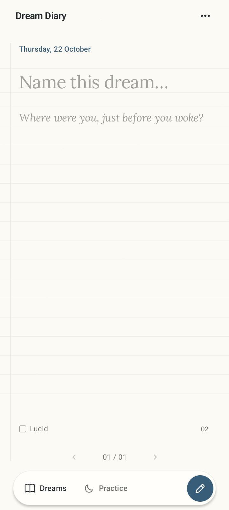

# Dream Diary

An Android dream journal with pages you can flip. Write, sketch, record voice notes, or dictate in **Croatian or English**. Mark lucid dreams with lavender paper and set reality-check reminders. Saved locally, with no account required.

**Android 8.0+ · Version 1.4.3 · Developer build**

## Screenshots

  
  &nbsp;&nbsp;
  

<em>Ivory for everyday entries. Lavender for lucid dreams.</em>

## Install

Download the APK, open it on your Android phone, and tap **Install**. [Installation help](dist/INSTALL.md).

[Build & feature details](DEVELOPMENT.md)
