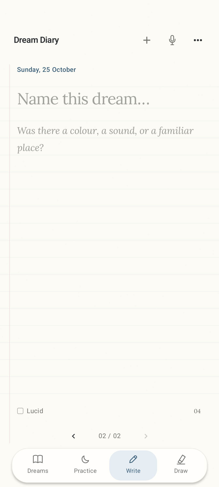

# Dream Diary

A paper-like Android dream journal. Write or draw on the page, dictate in **Croatian or English**, and mark lucid dreams with lavender paper. Includes voice notes and reality-check reminders. Saved locally, no account needed.

**Android 8.0+ · Version 1.5.0 · Developer build**

## Screenshots

  
  &nbsp;&nbsp;
  

<em>Ivory for everyday entries. Lavender for lucid dreams.</em>

## Install

Download the APK, open it on your Android phone, and tap **Install**. [Installation help](dist/INSTALL.md).

[Build & feature details](DEVELOPMENT.md)
